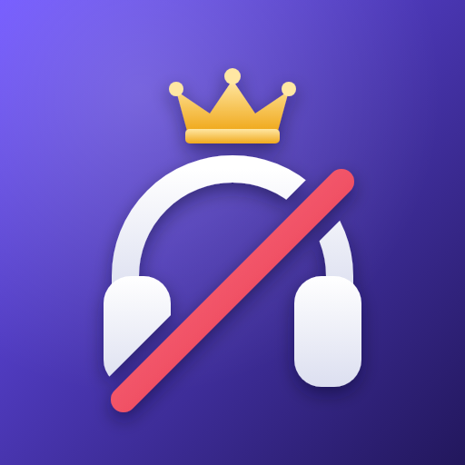

<p align="center">
  
</p>

<h1 align="center">Muteboard</h1>

<p align="center">
Ein Discord-Bot, der festhält, wer im Voice-Channel am meisten schweigt,<br>
und jede Woche die Ranglisten dazu postet.
</p>

---

## Features

- **Vier Ranglisten**
  - 🔇 **Full Mute**: Zeit, in der jemand selbst taub geschaltet ist (Kopfhörer aus)
  - 🎙️ **Nur Mute**: Mikro aus, aber nicht taub
  - 🤐 **Beides zusammen**: Summe aus beiden
  - 📊 **Stumm-Quote**: Anteil der eigenen Voice-Zeit, die man stumm war (mit Mindest-Voice-Zeit, damit 5 Minuten nicht für 100 % reichen)
- **Wochenpost**: jeden Sonntag um 20:00 (einstellbar) mit allen Ranglisten und den Siegern; wird nachgeholt, falls der Bot gerade offline war
- **Sieger-Rollen**: optional pro Rangliste eine Rolle, die jede Woche zum neuen Sieger wandert
- **`/muteboard`**: zeigt jede Rangliste jederzeit, für diese Woche oder gesamt
- **Robust**: speichert jede Minute (Absturz kostet höchstens 1 Minute), gleicht beim Start den aktuellen Voice-Status ab, Fehler beim Posten stoppen die Zeiterfassung nicht
- **Sparsam**: SQLite, keine privilegierten Intents, praktisch 0 % CPU

### Was zählt

| Zustand | Rangliste |
|---|---|
| Selbst taub | Full Mute |
| Nur Mikro aus | Nur Mute |
| Von einem Mod stumm/taub geschaltet | zählt nicht |
| Im AFK-Channel | zählt nicht (abschaltbar) |
| Bots | zählen nicht |

Taub schaltet in Discord automatisch auch das Mikro aus. Diese Zeit zählt nur als *Full Mute* und nicht zusätzlich als *Nur Mute*.

## Befehle

| Befehl | Beschreibung |
|---|---|
| `/muteboard` | Full-Mute-Rangliste dieser Woche |
| `/muteboard rangliste:<…> zeitraum:<…>` | Rangliste: Full Mute · Nur Mute · Beides zusammen · Stumm-Quote; Zeitraum: Diese Woche · Gesamt |

## Einrichtung

### 1. Bot im Discord Developer Portal anlegen

1. <https://discord.com/developers/applications> → *New Application* → *Bot* → *Reset Token* und den Token kopieren
2. Privilegierte Intents sind **nicht** nötig
3. *OAuth2 → URL Generator*: Scopes `bot` + `applications.commands`, Rechte:
   - View Channels, Send Messages, **Embed Links**
   - Manage Roles (nur für Sieger-Rollen)
4. Den generierten Link öffnen und den Server auswählen

> Ist der Post-Channel privat oder liegt er in einer privaten Kategorie, braucht der Bot dort zusätzlich
> eigene Channel-Berechtigungen (*Kanal ansehen*, *Nachrichten senden*, *Links einbetten*).
> Für Sieger-Rollen muss die Bot-Rolle in der Rollenliste **über** den Sieger-Rollen stehen.

### 2. Konfiguration

```bash
cp .env.example .env
```

| Variable | Standard | Bedeutung |
|---|---|---|
| `DISCORD_TOKEN` | – | Bot-Token (**geheim, nie committen**) |
| `LEADERBOARD_CHANNEL_ID` | – | Channel für den Wochenpost |
| `POST_WEEKDAY` / `POST_HOUR` / `POST_MINUTE` | `6` / `20` / `0` | Zeitpunkt des Wochenposts (0 = Montag … 6 = Sonntag) |
| `TIMEZONE` | `Europe/Berlin` | Zeitzone |
| `IGNORE_AFK_CHANNEL` | `1` | Zeit im AFK-Channel nicht zählen |
| `TOP_N` | `0` | Plätze pro Rangliste (0 = alle) |
| `PERCENT_BASIS` | `all` | Stumm-Quote: `all` (Mute + Full Mute) oder `deaf` |
| `PERCENT_MIN_MINUTES` | `120` | Mindest-Voice-Zeit pro Woche für die Stumm-Quote |
| `ROLE_DEAF_ID`, `ROLE_MUTE_ID`, `ROLE_ALL_ID`, `ROLE_PERCENT_ID` | leer | Sieger-Rolle pro Rangliste (leer = keine) |
| `DB_PATH` | `muteboard.db` | Pfad zur SQLite-Datenbank |

> Die `.env` muss **UTF-8** sein. Unter Windows im Editor beim Speichern darauf achten,
> sonst bricht der Bot mit `UnicodeDecodeError` ab.

### 3a. Lokal testen

```bash
python -m venv .venv
.venv\Scripts\activate          # Linux/macOS: source .venv/bin/activate
pip install -r requirements.txt
python bot.py
```

### 3b. Dauerhaft auf einem Linux-Server (systemd)

```bash
sudo apt install -y git python3-venv
sudo useradd --system --home /opt/muteboard --shell /usr/sbin/nologin muteboard
sudo git clone https://github.com/<USER>/muteboard.git /opt/muteboard
cd /opt/muteboard
sudo cp .env.example .env && sudo nano .env
sudo python3 -m venv .venv
sudo .venv/bin/pip install -r requirements.txt
sudo chown -R muteboard:muteboard /opt/muteboard
sudo chmod 600 .env
sudo cp muteboard.service /etc/systemd/system/
sudo systemctl daemon-reload
sudo systemctl enable --now muteboard
sudo git config --global --add safe.directory /opt/muteboard   # damit root später git pull darf
```

Die Unit-Datei startet den Bot nach Abstürzen automatisch neu und erlaubt ihm nur Schreibzugriff auf `/opt/muteboard`.

**Update:**

```bash
cd /opt/muteboard
sudo systemctl stop muteboard
sudo cp muteboard.db muteboard.db.bak
sudo git pull
sudo chown -R muteboard:muteboard /opt/muteboard
sudo systemctl start muteboard
```

**Logs und Status:**

```bash
systemctl status muteboard
journalctl -u muteboard -f
```

## Datenbank

Alle Zeiten liegen in `muteboard.db` (SQLite).
Die Stumm-Quote startet nach dem Update auf eine Version mit Voice-Zeit-Messung erst mit der nächsten vollen Woche,
damit die Quoten nicht verfälscht werden.

Für Backups reicht es, `muteboard.db` zu sichern, am besten bei gestopptem Bot.

## Lizenz

[MIT](LICENSE)
